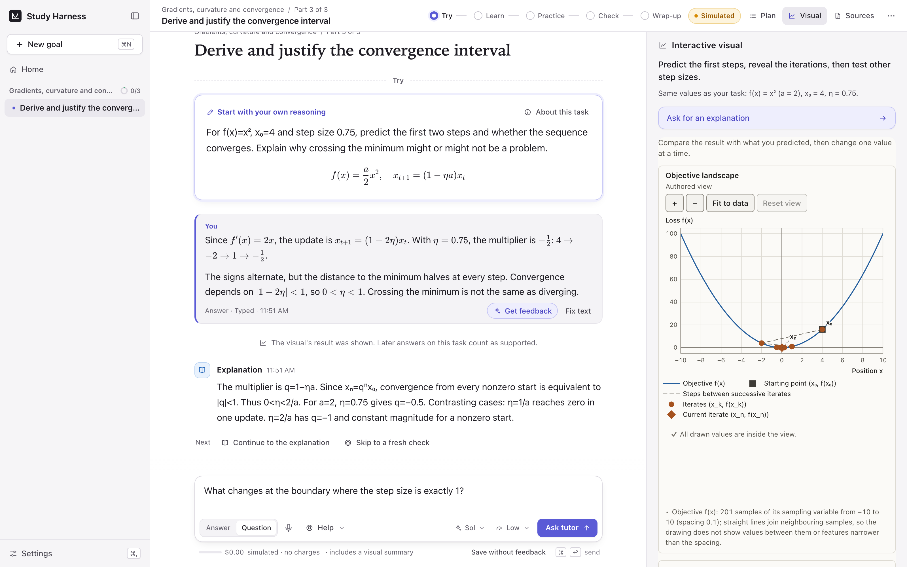

# Study Harness

**Think it through. Try it out. Show what you know.**

A local-first macOS workspace for learning STEM through your own reasoning. Start with a question, a topic, or your notes; shape a short study plan; then move between explanations, interactive experiments, practice, and fresh checks.



*An illustrative session in the real app, captured in offline development mode with the bundled Explorable Models player.*

## From a question to a study session

1. **Set your goal.** Describe what you want to understand or be able to do. Attach text, Markdown, or a text-based PDF, or paste your notes.
2. **Shape the plan.** Review a small set of concrete capabilities. Change the plan in plain language, choose where to start, or ask for a check on something you already know.
3. **Work through the idea.** Each lesson reads as one document that moves through **Try → Learn → Practice → Check**. Explain your reasoning in writing or with an editable voice transcript, ask questions, request a hint or worked example, and explore a relevant model when one is available. Support fades as you show what you can do: a fully correct reconstruction skips the remaining worked steps.
4. **Try it independently.** Fresh checks put earlier teaching and visuals away. The learning record distinguishes work done with help from work shown on your own.
5. **Return to it.** A wrap-up records what you explained, practised, and demonstrated. Spaced reviews bring back fresh problems for later checks.

The workspace follows macOS light or dark appearance (or your choice in **Settings → Study & display**) and is keyboard-first: <kbd>⌘</kbd><kbd>↩</kbd> sends, <kbd>⌘</kbd><kbd>N</kbd> starts a new goal, <kbd>⌘</kbd><kbd>B</kbd> or <kbd>⌘</kbd><kbd>\</kbd> toggles the sidebar, <kbd>⌘</kbd><kbd>,</kbd> opens Settings, and <kbd>Esc</kbd> closes a side panel.

Tasks and their reference answers are fixed before you see them. For supported numeric and symbolic tasks, the Rust core runs checks alongside the tutor’s assessment; a conflicting result holds the verdict for review. Corrections preserve the original work, and you can challenge feedback or report a flawed task.

## Interactive models, built in

Study Harness integrates [**Explorable Models**](https://github.com/jamesliuai/Explorable-Models), a separate visualization project, as its actual interactive player. Models compute locally and connect directly to the lesson: make a prediction, reveal the result, then change a parameter and inspect what happens.

| Model | Explore |
| --- | --- |
| Quadratic gradient descent | Step size, overshoot, and convergence |
| Function and derivative | Tangents, secants, and local slope |
| Linear transformation | How a 2×2 matrix transforms vectors and the plane |
| 3D vectors | Vector orientation, dot products, and cross products |
| Quadratic surface gradient | A surface, its gradient, and contour tangents |

The app bundles six pinned `@explorable-models/*` packages, including the 2D player and lazily loaded 3D renderer. The Rust host validates model parameters, records when results are revealed, and saves visual checkpoints with the study session. A bounded interaction summary can accompany a tutor request. Only capabilities with a relevant installed model get a visual.

No separate visualization server or source checkout is needed. See the [integration notes](docs/VISUALIZER.md) and [package manifest](vendor/visualizer/manifest.json) for the exact dependency boundary and source identity.

## Run locally

Requires **macOS 14 or later**, Node.js 22.12+, Rust/Cargo with Rust 2024 edition support, and Xcode Command Line Tools. Development has been exercised on Apple Silicon.

```sh
git clone https://github.com/jamesliuai/study-harness.git
cd study-harness
npm ci --ignore-scripts
npm run desktop
```

In **Settings → Tutor**, add your OpenAI API key for new plans, generated tasks, tutor feedback, and transcription. Choose the model and reasoning effort in Settings or beside the composer. Requests track usage against configurable limits, initially $1 per session and $10 per UTC month for each local profile.

**No key yet?** Choose **Try the sample unit** for eight authored capabilities on gradients, curvature, and convergence. Tasks, hints, examples, interactive models, and local saving work without a key; AI feedback requires one.

To build the macOS application:

```sh
npm run package
open "src-tauri/target/release/bundle/macos/Study Harness.app"
```

<details>
<summary>Offline development preview</summary>

Run the real application core with explicitly labelled simulated provider responses:

```sh
npm run desktop:offline
```

For the browser harness used to capture the README:

```sh
cargo build --manifest-path src-tauri/Cargo.toml \
  --bin offline-harness --features dev-tools,offline-provider
npm run dev -- --mode offline-test
```

Open `http://127.0.0.1:1420`. The harness creates a temporary SQLite database and makes no provider calls. Simulated responses exercise the workflow; they do not assess subject knowledge. Offline fixtures are excluded from production builds.

</details>

## Your work stays with you

Study history, source material, visual checkpoints, and review schedules live in a local SQLite database. There is no app account or cloud sync. Export a portable archive or a passphrase-protected backup, restore into a fresh profile, or preview the scope of a deletion before confirming it.

Explicit AI requests send the relevant task, answer, and bounded context to OpenAI; transcription sends the recording you choose to transcribe. API keys stay in memory or, when you choose to save them, macOS Keychain. See [privacy](docs/PRIVACY.md) and [backup and recovery](docs/RECOVERY.md).

## Development

The interface uses **React, TypeScript, and Tauri 2**. **Rust and SQLite** own tasks, attempts, assessment rules, review scheduling, and persistence. Generated IPC types and versioned JSON schemas keep the frontend and core aligned.

```sh
npm run check          # Production frontend build, Vitest, and Rust tests
npm run format:check   # Frontend formatting
```

[Architecture](docs/ARCHITECTURE.md) · [Goal-based learning](docs/GENERAL-LEARNING.md) · [Verification](docs/VERIFICATION.md)

## Status and credits

Study Harness is an early personal-use preview. Generated content can be wrong, symbolic checks use sampled agreement rather than proof, and code is assessed without execution. Live model quality and learning outcomes are not yet validated. Local macOS builds use ad-hoc signing; notarized distribution is not yet available.

Directly inspired by [**LearnHarness**](https://github.com/amosblomqvist/learnharness) by Eero Alvar, especially its emphasis on learner participation, explanation, and practice. Study Harness is independently implemented; see [attribution](docs/ATTRIBUTION.md). Interactive visualizations are provided by the MIT-licensed [Explorable Models](https://github.com/jamesliuai/Explorable-Models) project.

Licensed under the [MIT License](LICENSE). Third-party components retain their own licenses and notices in [`licenses/`](licenses/).
